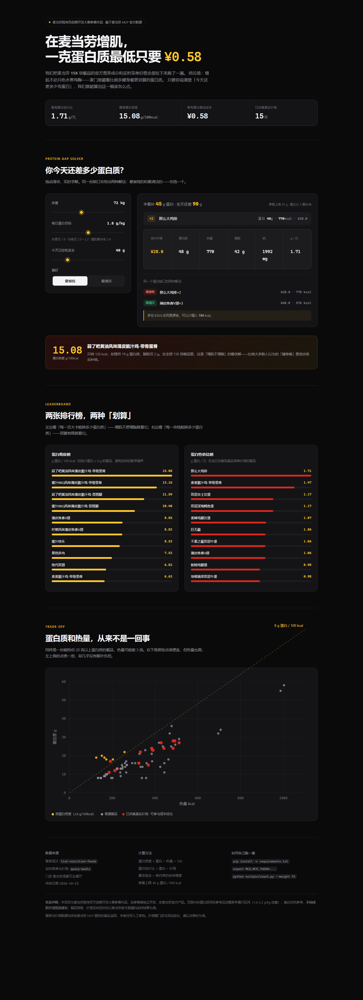

# 麦门增肌师 · McMuscle

> **在麦当劳增肌，一克蛋白质最低只要 ¥0.58。**

麦当劳有 158 项餐品的官方营养数据，但没有人告诉你：这堆数据里藏着一条极划算的高蛋白路线。

说清楚「今天还差多少克蛋白」，它算出这一顿该怎么点——给你两条路线：**最省钱的**和**最清淡的**。



**在线体验（无需安装，直接拖动滑块试算）：https://calvino-y.github.io/mcd-muscle-coach/**

## 它解决什么问题

增肌期想吃麦当劳，很多人第一反应是「今天算了」。但官方营养数据不支持这种自我劝退：

- **蒜了吧黄油风味薄皮脆汁鸡-带骨里脊**：19 g 蛋白质，只有 **126 kcal**，脂肪 2 g。蛋白密度 **15.08 g/100kcal**——在全部 158 项餐品里排第一。
- **那么大鸡排**：24 g 蛋白质，¥14，蛋白性价比 **1.71 g/元**，是全场最高的一档。
- 而**巨无霸**的蛋白性价比是 1.06 g/元，排第 6——数据说明的是「目标不同，最优解就不同」，不涉及谁好谁坏。

问题从来不是「麦当劳能不能吃」，而是「**在这 158 项里怎么组合**」。而这恰好是大模型口算最容易出错的地方：人脑和 LLM 都会漏掉「两份小食拼起来比一份套餐更划算」这类解。

## 快速开始

```bash
git clone https://github.com/Calvino-Y/mcd-muscle-coach.git
cd mcd-muscle-coach

# 1. 领取免费的麦当劳 MCP Token（手机号登录，控制台点激活）
#    https://open.mcd.cn/mcp
export MCD_MCP_TOKEN="你的 Token"        # Windows: set MCD_MCP_TOKEN=...

# 2. 生成数据集（仓库里已带一份 2026-10-15 的真实快照，可跳过）
python scripts/build_dataset.py

# 3. 求解
python scripts/coach.py --weight 72 --factor 1.8 --consumed 40
```

输出：

```
体重 72 kg × 1.8 g/kg = 每日目标 130 g 蛋白
今日已摄入 40 g → 全天还差 90 g
单餐最多补 45 g，建议分 2 餐吃完，本餐先补 45 g

本餐推荐（最省钱）：
  · 那么大鸡排 ×2   ¥ 28.0   蛋白   48g   热量  770kcal

  合计 ¥28.0   蛋白 48.0g   热量 770kcal   脂肪 42.0g   钠 1992mg
  蛋白性价比 1.71 g/元   蛋白密度 6.23 g/100kcal

同一个蛋白缺口的两种解法：
  最省钱  ¥ 28.0    770kcal   那么大鸡排×2
  最清淡  ¥ 48.0    576kcal   薄皮焦香V翅×3
  → 多花 ¥20.0 可以少摄入 194 kcal、少 9.0 g 脂肪
```

### 参数

| 参数 | 说明 |
|---|---|
| `--weight` | 体重 kg |
| `--factor` | 每公斤体重目标蛋白：休息日 `1.6`，训练日 `2.0`–`2.2`，增肌冲刺 `2.4` |
| `--consumed` | 今天已经吃进去的蛋白克数 |
| `--mode` | `budget` 最省钱 / `lean` 最低热量 |
| `--meal-cap` | 单餐蛋白上限，默认 45 g |
| `--kcal-cap` | 本餐热量上限，默认 900 kcal |

## 可视化面板

```bash
python scripts/render_dashboard.py   # 生成 docs/index.html
```

面板包含四块：

1. **蛋白缺口计算器**——拖动体重 / 目标 / 已摄入三个滑块，实时求解，同时展示两条路线
2. **蛋白密度榜**——每 100 kcal 能换多少蛋白质
3. **蛋白性价比榜**——每一块钱能换多少蛋白质
4. **蛋白 × 热量 散点图**——一眼看出哪些餐品在「高蛋白低热量」的前沿上

在线面板已部署在 GitHub Pages：https://calvino-y.github.io/mcd-muscle-coach/

（自行部署：Settings → Pages → 选 `main` 分支的 `/docs` 目录即可。）

## 它是怎么算的

```
缺口 = 体重 × 目标系数 − 已摄入
单餐缺口 = min(缺口, 45 g)              ← 加上限，避免推荐 1500 kcal 的一餐
在满足「总蛋白 ≥ 单餐缺口」的组合中，求总价最低 / 总热量最低
```

搜索空间：最多 3 种餐品（每种最多 2 份），或单一餐品最多 6 份，共 **4150 个候选解**，穷举精确求解，无启发式近似。

**为什么必须有单餐上限**：如果不设上限，把 90 g 蛋白缺口交给一顿麦当劳，结果会是 1540 kcal。算法上没算错，营养上是错的。所以工具会主动告诉你「本餐先补 45 g，剩下的分 2 餐」。

**为什么前后端各写一份求解器**：`scripts/coach.py` 给命令行和批量任务用，网页里那份给不装 Python 的人用。两份实现用 12 个场景对拍，结果必须逐字段一致：

```bash
python scripts/export_parity_fixture.py && node tests/test_solver_parity.mjs
```

## 目标用户

- **健身人群**：增肌期需要吃够 1.6–2.2 g/kg 蛋白，但外食选择有限
- **加班族 / 学生**：晚上十点只剩麦当劳开门，想知道这一顿吃得值不值
- **控糖控脂人群**：需要「高蛋白低热量」，散点图左上角那块就是他们的菜单
- **所有想知道自己那张优惠券该配合什么吃的人**

## 项目结构

```
mcd-muscle-coach/
├── SKILL.md                      # WorkBuddy Skill 定义（本仓库根目录即 Skill 目录）
├── scripts/
│   ├── mcd_client.py             # 麦当劳 MCP 客户端（标准库，零依赖）
│   ├── build_dataset.py          # 营养数据 + 价格 -> data/menu.json
│   ├── coach.py                  # 求解器 CLI
│   ├── render_dashboard.py       # 生成 docs/index.html
│   └── export_parity_fixture.py  # 生成对拍基准
├── data/
│   ├── nutrition_raw.txt         # list-nutrition-foods 的原始响应快照
│   └── menu.json                 # 整理后的数据集（含派生指标）
├── assets/
│   └── dashboard-template.html   # 面板模板
├── docs/
│   └── index.html                # 可视化面板（GitHub Pages）
├── references/
│   └── mcp-tools.md              # MCP 工具参数速查
└── tests/
    └── test_solver_parity.mjs    # 前后端求解器对拍
```

## 作为 WorkBuddy Skill 安装

```bash
git clone https://github.com/Calvino-Y/mcd-muscle-coach.git \
  ~/.workbuddy/skills/mcd-muscle-coach
```

然后在 WorkBuddy 里说「我今天还差 40 克蛋白」或「练后在麦当劳吃什么」，Skill 会自动触发。

## 数据来源

全部来自麦当劳 MCP 服务的真实返回，**没有任何人工编造的数字**：

| 数据 | MCP 工具 |
|---|---|
| 营养成分（能量/蛋白/脂肪/碳水/钠/钙） | `list-nutrition-foods` |
| 实时菜单与价格 | `query-meals` |
| 门店解析 | `query-nearby-stores` / `delivery-query-stores` |

采样门店：麦当劳成都万达餐厅（`storeCode=3450032`），采样日期 2026-10-15。

## 免责声明

本项目为**麦当劳程序员节创意开发大赛参赛作品**，由参赛者独立开发，非麦当劳官方产品。

页面与命令行的蛋白质目标参考运动营养学通行区间（1.6–2.2 g/kg 体重），输出**仅供参考，不构成医疗或营养建议**。餐品信息、价格及供应状态以麦当劳官方渠道的实时结果为准。

患有肾脏疾病、代谢疾病、处于孕期或哺乳期、以及未成年人，请勿依据本工具调整饮食，请咨询专业医师或注册营养师。

## License

MIT
