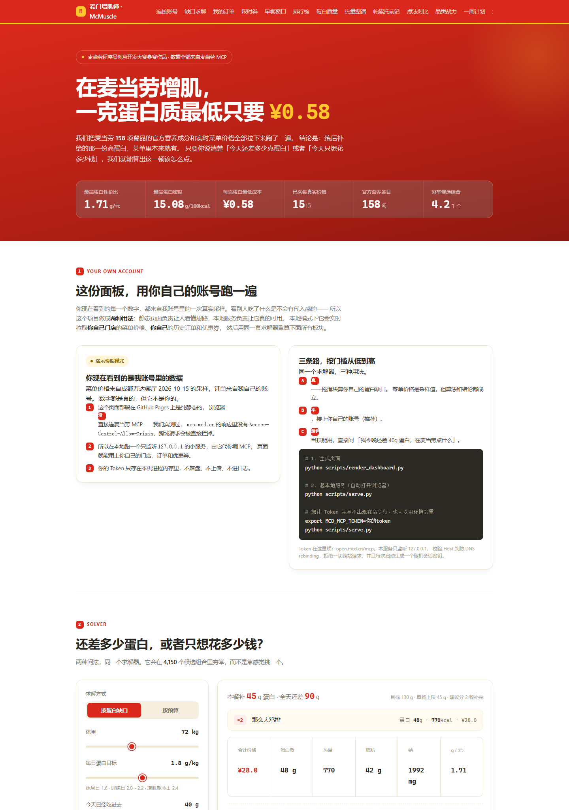

# 麦门增肌师 · McMuscle

> **在麦当劳增肌，一克蛋白质最低只要 ¥0.58——用上限时券可以压到 ¥0.47。**

麦当劳有 158 项餐品的官方营养数据，但没有人告诉你：这堆数据里藏着一条极划算的高蛋白路线。

说清楚「今天还差多少克蛋白」，它算出这一顿该怎么点——给你两条路线：**最省钱的**和**最清淡的**。



**在线体验（无需安装，直接拖动滑块试算）：https://calvino-y.github.io/mcd-muscle-coach/**

**想用自己账号的数据？** 把仓库拉下来跑 `python scripts/serve.py`，页面上填自己的 MCP Token，
就能实时拉取**你自己的**门店、菜单、订单和卡包券——详见 [本地工具模式](#本地工具模式不是看我的数据是看你的)。

完整面板长图：[docs/preview-full.png](docs/preview-full.png)

## 它解决什么问题

增肌期想吃麦当劳，很多人第一反应是「今天算了」。但官方营养数据不支持这种自我劝退：

- **蒜了吧黄油风味薄皮脆汁鸡-带骨里脊**：19 g 蛋白质，只有 **126 kcal**，脂肪 2 g。蛋白密度 **15.08 g/100kcal**——在全部 158 项餐品里排第一。
- **那么大鸡排**：24 g 蛋白质，¥14，蛋白性价比 **1.71 g/元**，是全场最高的一档。
- 而**巨无霸**的蛋白性价比是 1.06 g/元，排第 6——数据说明的是「目标不同，最优解就不同」，不涉及谁好谁坏。

问题从来不是「麦当劳能不能吃」，而是「**在这 158 项里怎么组合**」。而这恰好是大模型口算最容易出错的地方：人脑和 LLM 都会漏掉「两份小食拼起来比一份套餐更划算」这类解。

## 快速开始

```bash
git clone https://github.com/Calvino-Y/mcd-muscle-coach.git
cd mcd-muscle-coach

# 1. 领取免费的麦当劳 MCP Token（手机号登录，控制台点激活）
#    https://open.mcd.cn/mcp
export MCD_MCP_TOKEN="你的 Token"        # Windows: set MCD_MCP_TOKEN=...

# 2. 生成数据集（仓库里已带一份 2026-10-15 的真实快照，可跳过）
python scripts/build_dataset.py
python scripts/build_orders.py     # 可选：用你自己的 order-list 数据重建订单体检
python scripts/build_coupons.py    # 可选：用你自己的卡包券重建券 × 蛋白效率板块

# 3. 求解
python scripts/coach.py --weight 72 --factor 1.8 --consumed 40

# 4. 重新生成可视化面板
python scripts/render_dashboard.py
```

输出：

```
体重 72 kg × 1.8 g/kg = 每日目标 130 g 蛋白
今日已摄入 40 g → 全天还差 90 g
单餐最多补 45 g，建议分 2 餐吃完，本餐先补 45 g

本餐推荐（最省钱）：
  · 那么大鸡排 ×2   ¥ 28.0   蛋白   48g   热量  770kcal

  合计 ¥28.0   蛋白 48.0g   热量 770kcal   脂肪 42.0g   钠 1992mg
  蛋白性价比 1.71 g/元   蛋白密度 6.23 g/100kcal

同一个蛋白缺口的两种解法：
  最省钱  ¥ 28.0    770kcal   那么大鸡排×2
  最清淡  ¥ 48.0    576kcal   薄皮焦香V翅×3
  → 多花 ¥20.0 可以少摄入 194 kcal、少 9.0 g 脂肪
```

### 参数

| 参数 | 说明 |
|---|---|
| `--weight` | 体重 kg |
| `--factor` | 每公斤体重目标蛋白：休息日 `1.6`，训练日 `2.0`–`2.2`，增肌冲刺 `2.4` |
| `--consumed` | 今天已经吃进去的蛋白克数 |
| `--mode` | `budget` 最省钱 / `lean` 最低热量 |
| `--meal-cap` | 单餐蛋白上限，默认 45 g |
| `--kcal-cap` | 本餐热量上限，默认 900 kcal |

## 可视化面板

```bash
python scripts/render_dashboard.py   # 生成 docs/index.html
```

面板一共十三块（★ 为本次新增）：

1. ★ **你的账号**——两种用法入口：看演示快照，或跑 `serve.py` 用自己的账号跑一遍；三条路线（MCP 原始调用 / CLI / 本地工具）按门槛从低到高排好
2. **蛋白缺口求解器**——两种问法：按缺口补（体重/目标/已摄入三个滑块），或按预算吃（「¥30 最多能买到多少克蛋白」），并画出**预算边际收益曲线**，看钱花到哪一档开始不划算
3. **你的真实订单体检**——接入 `order-list` 的真实历史订单，逐单对齐官方营养表，回答「你自己在麦当劳点了什么、吃进去多少蛋白、离目标差多远」
4. ★ **限时券 × 蛋白效率**——卡包里的券不是「省几块钱」，而是「每克蛋白多少钱」：中薯条买一送一算下来 **0.59 g/元**，火腿扒堡早餐两件套把每克蛋白压到 **¥0.47–0.71**，比菜单原价冠军（那么大鸡排 ¥0.58/克）还低；配一张**一周券日历**（按星期 × 时段排布，今天高亮）
5. ★ **早餐增肌窗口**——早上 5 点到 10 点半是被整个菜单漏掉的时段：17 项早餐餐品的蛋白密度排名，单份最高 29 g，最高密度 6.48 g/100kcal；到店菜单不返回早餐价格，板块如实标注而非估算
6. **蛋白密度榜 / 蛋白性价比榜**——每 100 kcal、每一块钱各能换多少蛋白质
7. **蛋白质量榜**——把「每 10 g 蛋白附赠多少钠、多少钙、多少脂肪」单独拎出来排，可切换排序
8. **蛋白 × 热量散点图**——一眼看出哪些餐品在「高蛋白低热量」的前沿上
9. ★ **帕累托前沿**——蛋白更多、热量更低、价格更便宜三个维度同时看：15 项候选里只有 6 项不存在任何劣化，**巨无霸被双层深海鳕鱼堡全面支配**（27 g/513 kcal/¥25.5 vs 28 g/485 kcal/¥24.0）——有名不等于最优
10. **点法对比表**——同样凑够 45 g 蛋白，算法组合方案 vs 单品硬点，差价一目了然
11. **品类战力榜**——按官方原始分类聚合，看哪一类整体最能打
12. **一周补给计划**——训练日 45 g / 休息日 25 g，七天方案与总花费，随偏好联动
13. ★ **分享卡片**——把当前求解结果画成一张可直接发出去的 PNG（canvas 本地绘制，不上传任何数据），配文可一键复制；你改一次参数，卡片跟着变

在线面板已部署在 GitHub Pages：https://calvino-y.github.io/mcd-muscle-coach/

（自行部署：Settings → Pages → 选 `main` 分支的 `/docs` 目录即可。）

## 本地工具模式（不是看我的数据，是看你的）

GitHub Pages 上的是演示快照——我的账号、我附近的门店。要让面板跑在**你自己的数据**上：

```bash
git clone https://github.com/Calvino-Y/mcd-muscle-coach.git
cd mcd-muscle-coach
python scripts/serve.py
```

浏览器会自动打开 `http://127.0.0.1:8765`。页面第一个板块会从「演示快照模式」变成
「本地工具模式」，把你的 MCP Token 填进去点连接，面板会实时拉取：

- 你附近门店的**实时菜单与价格**（换城市也一样准）
- 你的**历史订单**（订单体检板块变成你的账单）
- 你的**卡包券 + 门店券**（券板块变成你的券）

零依赖：只用 Python 标准库，无需 pip install；Token 只存在本机内存里，不落盘、不回显、
不上传任何第三方。页面与后端之间的每一次 API 调用都要求会话密钥（`X-McMuscle-Key`）。

**为什么需要一个本地服务，而不能让网页直接调 MCP？** 我们实测过：`https://mcp.mcd.cn`
的响应**不带 CORS 头**（浏览器直连会被同源策略拦下）。这不是缺陷，是安全设计——
Token 就不该交给浏览器保管。所以由本地进程代理 MCP 调用，网页只跟 `127.0.0.1` 说话。

安全闸门（`tests/test_serve.py` 端到端验证）：

| 防线 | 行为 |
|---|---|
| 只绑定 `127.0.0.1` | 局域网内其他设备连不上 |
| `Host` 头校验 | 防 DNS rebinding（伪造域名访问本地服务 → 403） |
| 跨站 `Origin` 拒绝 | 其他网页无法借你的浏览器调用本地 API |
| 会话密钥 | 每次启动随机生成，API 调用必须携带 → 401 |
| Token 不落盘 | 只在内存；`/api/status` 不回显；页面注入前做泄漏扫描 |
| 降级友好 | 未连接账号时业务接口返回 409 并提示，而不是 500 崩掉 |

## 它是怎么算的

```
缺口 = 体重 × 目标系数 − 已摄入
单餐缺口 = min(缺口, 45 g)              ← 加上限，避免推荐 1500 kcal 的一餐
在满足「总蛋白 ≥ 单餐缺口」的组合中，求总价最低 / 总热量最低
```

搜索空间：最多 3 种餐品（每种最多 2 份），或单一餐品最多 6 份，共 **4150 个候选解**，穷举精确求解，无启发式近似。

**为什么必须有单餐上限**：如果不设上限，把 90 g 蛋白缺口交给一顿麦当劳，结果会是 1540 kcal。算法上没算错，营养上是错的。所以工具会主动告诉你「本餐先补 45 g，剩下的分 2 餐」。

**为什么前后端各写一份求解器**：`scripts/coach.py` 给命令行和批量任务用，网页里那份给不装 Python 的人用。两份实现用 12 个场景对拍，结果必须逐字段一致：

```bash
python scripts/export_parity_fixture.py && node tests/test_solver_parity.mjs
```

## 验证链

改任何东西之后，四条检查都要跑：

```bash
node tests/check_page.mjs                                      # 页面自检：占位符/语法/数据/结构/挂载点
node tests/test_solver_parity.mjs                              # 前后端求解器逐字段对拍
python tests/test_serve.py                                     # 本地服务安全闸门端到端测试
python tests/browser_check.py                                  # 无头浏览器真跑一遍页面
```

## 目标用户

- **健身人群**：增肌期需要吃够 1.6–2.2 g/kg 蛋白，但外食选择有限
- **加班族 / 学生**：晚上十点只剩麦当劳开门，想知道这一顿吃得值不值
- **控糖控脂人群**：需要「高蛋白低热量」，散点图左上角那块就是他们的菜单
- **所有想知道自己那张优惠券该配合什么吃的人**

## 项目结构

```
mcd-muscle-coach/
├── SKILL.md                      # WorkBuddy Skill 定义（本仓库根目录即 Skill 目录）
├── scripts/
│   ├── mcd_client.py             # 麦当劳 MCP 客户端（标准库，零依赖）
│   ├── serve.py                  # 本地工具模式：MCP 代理 + 安全闸门（零依赖）
│   ├── build_dataset.py          # 营养数据 + 价格 -> data/menu.json
│   ├── build_orders.py           # 历史订单 + 营养对齐 -> data/orders.json
│   ├── build_coupons.py          # 卡包券 + 门店券 -> data/coupons.json
│   ├── coach.py                  # 求解器 CLI
│   ├── render_dashboard.py       # 生成 docs/index.html
│   └── export_parity_fixture.py  # 生成对拍基准
├── data/
│   ├── nutrition_raw.txt         # list-nutrition-foods 的原始响应快照
│   ├── orders_raw.json           # order-list 的原始响应快照（orderId 已脱敏）
│   ├── coupons_raw.json          # query-my-coupons / query-store-coupons 的原始快照
│   ├── menu.json                 # 整理后的数据集（含派生指标）
│   ├── orders.json               # 逐单营养对齐结果
│   └── coupons.json              # 券 × 蛋白效率（含无法对齐的诚实标注）
├── assets/
│   └── dashboard-template.html   # 面板模板（静态演示 / 本地工具双模式）
├── docs/
│   ├── index.html                # 可视化面板（GitHub Pages）
│   ├── preview-top.png           # README 头图
│   └── preview-full.png          # 完整面板长图
├── references/
│   └── mcp-tools.md              # MCP 工具参数速查
└── tests/
    ├── test_solver_parity.mjs    # 前后端求解器对拍
    ├── check_page.mjs            # 页面自检（占位符/语法/数据/结构/挂载点）
    ├── browser_check.py          # 无头浏览器渲染检查（真跑一遍页面）
    ├── test_serve.py             # serve.py 安全闸门端到端测试
    └── make_preview.py           # 生成 README 预览图
```

## 作为 WorkBuddy Skill 安装

```bash
git clone https://github.com/Calvino-Y/mcd-muscle-coach.git \
  ~/.workbuddy/skills/mcd-muscle-coach
```

然后在 WorkBuddy 里说「我今天还差 40 克蛋白」或「练后在麦当劳吃什么」，Skill 会自动触发。

## 数据来源

全部来自麦当劳 MCP 服务的真实返回，**没有任何人工编造的数字**：

| 数据 | MCP 工具 |
|---|---|
| 营养成分（能量/蛋白/脂肪/碳水/钠/钙） | `list-nutrition-foods` |
| 实时菜单与价格 | `query-meals` |
| 历史订单（「你的真实订单体检」板块） | `order-list` |
| 卡包券与门店券（「限时券 × 蛋白效率」板块） | `query-my-coupons` / `query-store-coupons` |
| 门店解析 | `query-nearby-stores` / `delivery-query-stores` |

采样门店：麦当劳成都万达餐厅（`storeCode=3450032`），采样日期 2026-10-15。

**关于订单营养的诚实口径**：订单里的餐品只有一部分能在官方营养表里找到对应条目（当前快照覆盖率 55%）。
找不到的（比如点了 7 次的「培根芝士双牛堡」）会被标为「未匹配」，该单品蛋白计 0，并在页面上写明覆盖率——
我们宁可让数字偏小，也不拿相近餐品去估一个好看的值。

**关于券的诚实口径**：8 张券里有 3 张（王牌小食拼、芝香脆鸡扒堡早餐两件套、高达芝士蛋堡早餐两件套）
在官方营养表里**没有对应条目**，无法算出蛋白效率。这些券在页面上标为「无法对齐」并写明原因，
而不是拿相近餐品凑数；早餐两件套因为实际配餐（咖啡换鲜奶等）存在浮动，给的是**区间**（如 1.41–2.12 g/元）并注明推算依据。
17 项早餐餐品的菜单价格同理：到店菜单不返回早餐价格，页面直接写「0 项带价格」而不是编一个。

## 免责声明

本项目为**麦当劳程序员节创意开发大赛参赛作品**，由参赛者独立开发，非麦当劳官方产品。

页面与命令行的蛋白质目标参考运动营养学通行区间（1.6–2.2 g/kg 体重），输出**仅供参考，不构成医疗或营养建议**。餐品信息、价格及供应状态以麦当劳官方渠道的实时结果为准。

患有肾脏疾病、代谢疾病、处于孕期或哺乳期、以及未成年人，请勿依据本工具调整饮食，请咨询专业医师或注册营养师。

## License

MIT
